# Empyrion Admin Manager (EAM)

**English** · [Français](#français)

Free and open-source (MIT) administration tool for **Empyrion - Galactic Survival** dedicated servers.
Install and run one or several servers from a single Windows desktop app, or manage them remotely from any browser:
SteamCMD, backups, scheduler, live players and chat, structures, maps, chatbot, Discord, anti-cheat, logs, statistics, mods and events.

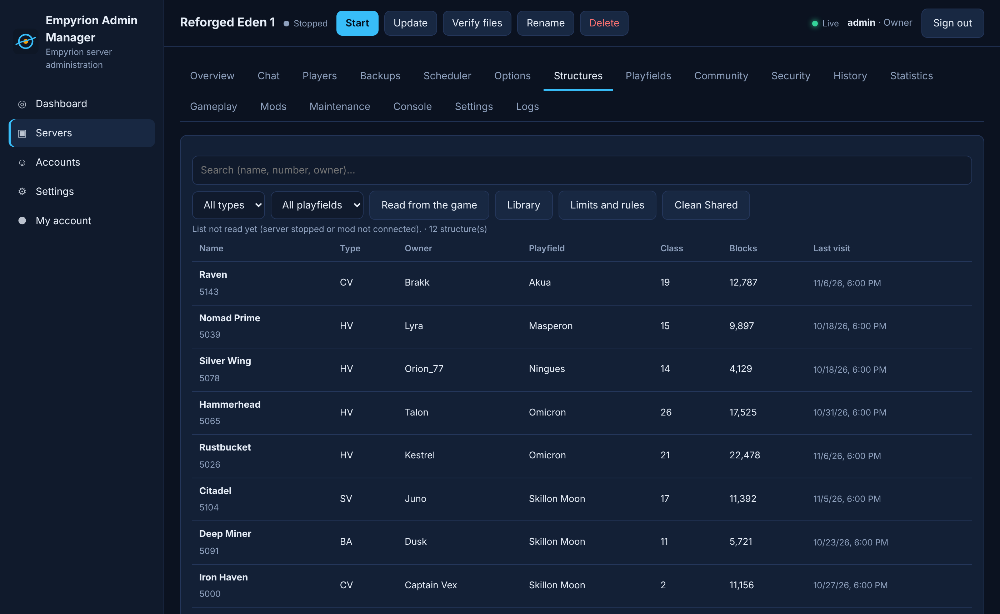

> **Status:** version 0.9.x, under active testing. It is ready to try on a test server.
> Keep your production servers on your current tool until version 1.0.

## Contents

- [Why EAM](#why-eam)
- [Features](#features)
- [Requirements](#requirements)
- [Quick start (tutorial)](#quick-start-tutorial)
- [The desktop app and the web panel](#the-desktop-app-and-the-web-panel)
- [How it works](#how-it-works)
- [Accounts and roles](#accounts-and-roles)
- [Remote access and HTTPS](#remote-access-and-https)
- [Players' chatbot commands](#players-chatbot-commands)
- [Where the data lives](#where-the-data-lives)
- [Updating EAM](#updating-eam)
- [Troubleshooting](#troubleshooting)
- [Building from source](#building-from-source)
- [Roadmap](#roadmap)
- [License](#license)

## Why EAM

- **One program for everything.** The functions of a server admin helper and of a web access tool are in one place, in a desktop window and in a browser.
- **Several servers on one machine.** Each server gets its own folder, its own ports, its own database and its own backups. Ports are chosen and checked automatically.
- **Nothing to install by hand.** SteamCMD is downloaded on first use. Empyrion, Reforged Eden 1 and Reforged Eden 2 are installed from EAM.
- **Safe by design.** Only one heavy operation at a time per server, a backup before anything risky, nothing deleted without being moved aside first.
- **Written from scratch** and free (MIT license). No code copied from other tools.

## Features

### Servers
- Built-in SteamCMD, downloaded automatically into the EAM folder.
- Create a server with any name (EAM name, folder and name shown in the game's server list), rename it later.
- Install, update and verify Empyrion from EAM, with live progress (stable or experimental branch).
- Several fully separate servers: one folder each, ports allocated and checked, an EAM-owned `dedicated-eam.yaml` that Steam never overwrites.
- Start, stop with a player warning and a cancellable countdown, restart, force stop.
- Crash detection, automatic restart, suspended after 3 crashes in 15 minutes.
- Telnet console, game log and EAM log of each server.

### Live view
- Online players (faction, playfield, level, ping, session time), active playfields (players, FPS, memory, structures), server FPS.
- CPU and memory of each server (all of its processes).
- Live chat with 90 days of history; send a message in the chat or as a pop-up on the players' screens.
- Notifications when a player joins or leaves.

### Backups and scheduler
- Backups of the save game, players' blueprints, `adminconfig.yaml`, options and EAM data. Created while the server runs.
- Download, delete, restore (server stopped, with a safety backup first). Keep the last N automatic backups.
- Extra copy to a synchronised folder (Google Drive, OneDrive...).
- Scheduler: restart (with warnings and a backup first), stop, start, backup, message, console command, playfield wipe, log cleanup, game update. Fixed times per weekday or interval. "Run now" button.

### Options and scenarios
- Every option of `dedicated.yaml` (active or commented in the game's template, with its help text) and full-file editing.
- Save name, scenario, game mode, seed.
- Every game option of the save (`gameoptions.yaml`).
- Installed scenarios, install and update Reforged Eden 1 and 2 (or any scenario) from the Steam Workshop, always the latest version. Import from a folder, delete.

### Players
- Every player ever seen, detailed sheet, editable inventory, credits, experience and upgrade points.
- Give items (catalogue translated from the scenario), teleport, heal, finish a blueprint.
- Private message (delivered at the next login if the player is offline), kick, ban and unban, list of banned players.
- Roles in `adminconfig.yaml`, full history of connections and admin actions.

### Structures and world
- Full structure list (filter by type, playfield, owner, power), detailed sheet (blocks, devices, items), history of each structure.
- Rename, change owner, move (to a playfield, a position or a player), export, clone, destroy (exported first), restore from the EAM library.
- Blueprints (.epb): import, list, spawn in game. Clean the `Shared` folder (folders of removed structures are moved aside, never deleted).
- Limits per player or faction (count, class, blocks, per playfield): warning then removal after a delay.
- Automatic wipes (unvisited structures, starter playfields), playfields reserved to some players or factions.
- Playfields: list, load, wipe. 2D/3D map of structures and players. Galaxy map.

### Community
- Players' chatbot with a prefix of your choice (see [commands](#players-chatbot-commands)), plus custom commands.
- Alerts (watched words, serious events) with sound and notification.
- Chat translation, insult filter (warnings then progressive bans), muted players.
- Message of the day, welcome message, message when entering a playfield.
- Discord bridge: global chat both ways, faction channels, admin channel for alerts.

### Security
- Anti-cheat: forbidden items, oversized stacks, health and food, credit jumps. Optional automatic ban.
- Base attack log, "what happened here" history (player and structure positions over 14 days), player tracking.
- Pole control, emergency teleport on logout, protection against telnet flooding.
- 7-day statistics: players, FPS, memory, playfields, deaths, cores placed and removed, with advice.

### Gameplay extras
- Autominer: virtual miners bought with credits, fuel, limited stock, 13 ores by default.
- Events: player registration, start with a kit and a teleport, inventory set aside and given back, return to the original position (even if the player was offline).
- Mod manager: install (.zip or .dll), enable, disable, delete (kept aside), edit settings files with a copy of the old one.

### Maintenance and platform
- Compact the databases, "fresh start" for a new season (backup first), find damaged player files, item number converter.
- Free HTTPS certificate from Let's Encrypt, renewed automatically.
- Accounts with 5 roles, hashed passwords (PBKDF2), lock after 5 failed sign-ins.
- English and French interface.

## Requirements

- Windows 10/11 or Windows Server 2019 or later, 64-bit.
- Microsoft Edge WebView2 for the desktop window (already present on most Windows installs).
- Disk space for the game and its scenario on each server, plus backups.
- Nothing else: EAM is self-contained (no .NET to install).

## Quick start (tutorial)

**1. Download.** Get `EmpyrionAdminManager-X.Y.Z.zip` from the [Releases](../../releases) page and unzip it anywhere, for example `C:\EmpyrionAdminManager`.

**2. Start EAM.** Run `EmpyrionAdminManager.exe`. The window starts the engine and asks you to create the first administrator account. This first account can only be created on the EAM machine itself.

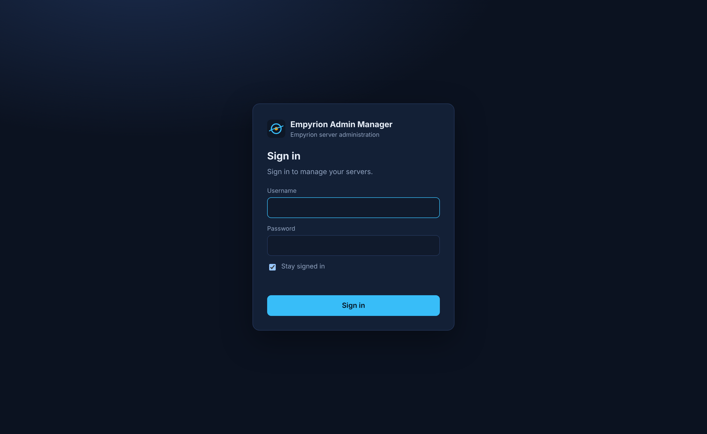

**3. Dashboard.** You see the machine's processor, memory and disks, and the list of your servers.

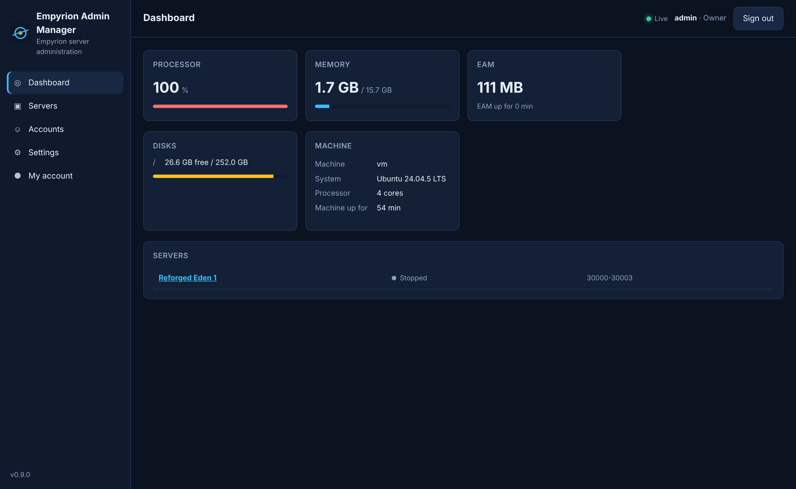

**4. Create a server.** Open **Servers**, click **New server**, choose a name, the branch (stable or experimental) and the options. Ports are picked for you.

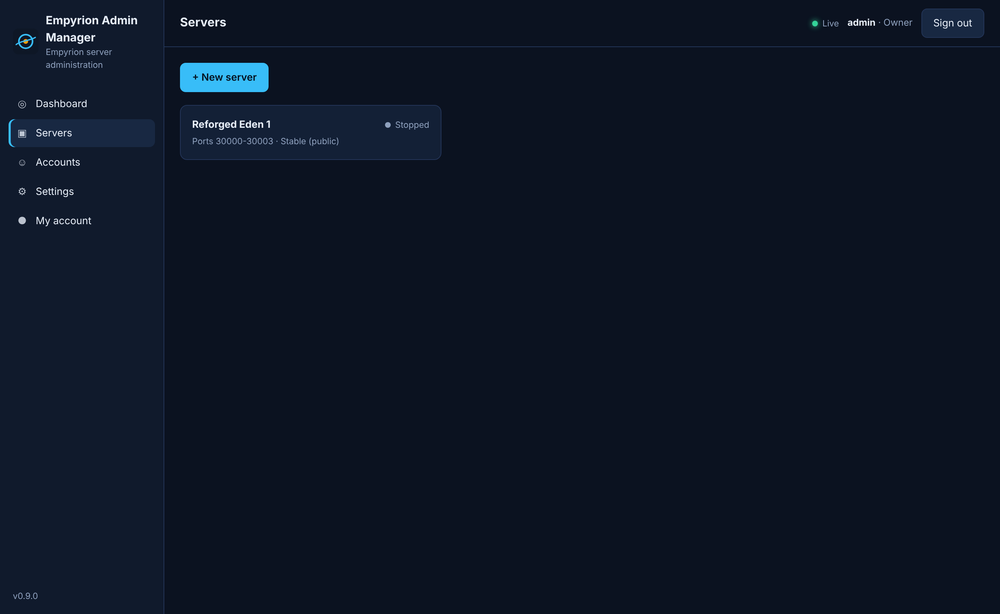

**5. Install the game.** On the server page, click **Install**. EAM downloads SteamCMD the first time, then Empyrion. Progress is shown live.

**6. Choose the scenario.** In **Options**, install Reforged Eden 1 or 2 from the Steam Workshop (or keep the default scenario), set the save name, the mode and the seed, and adjust any option of the game.

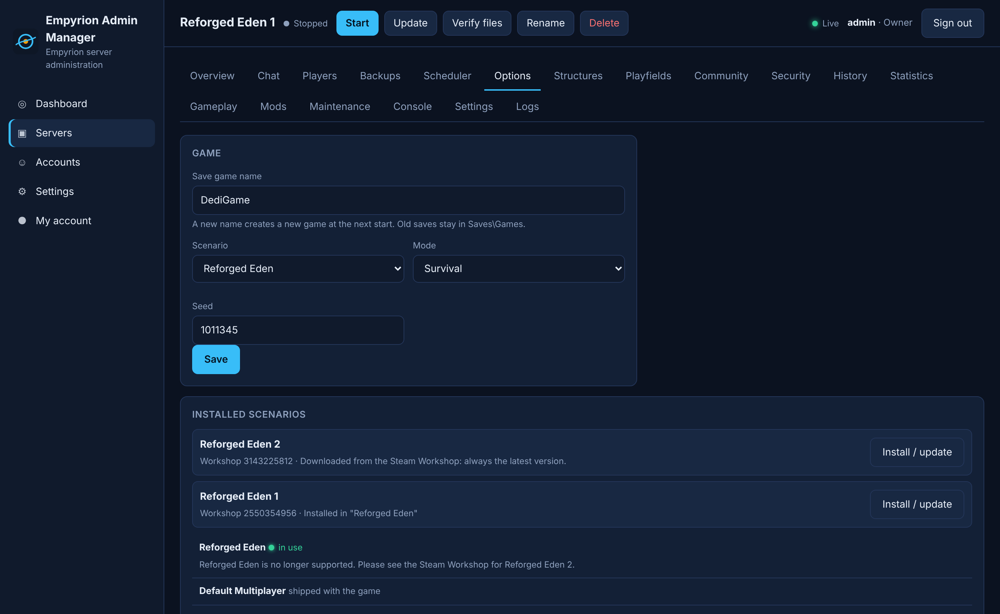

**7. Start the server.** Click **Start**. EAM installs its own small mod in the server, then the live view shows players, playfields and chat.

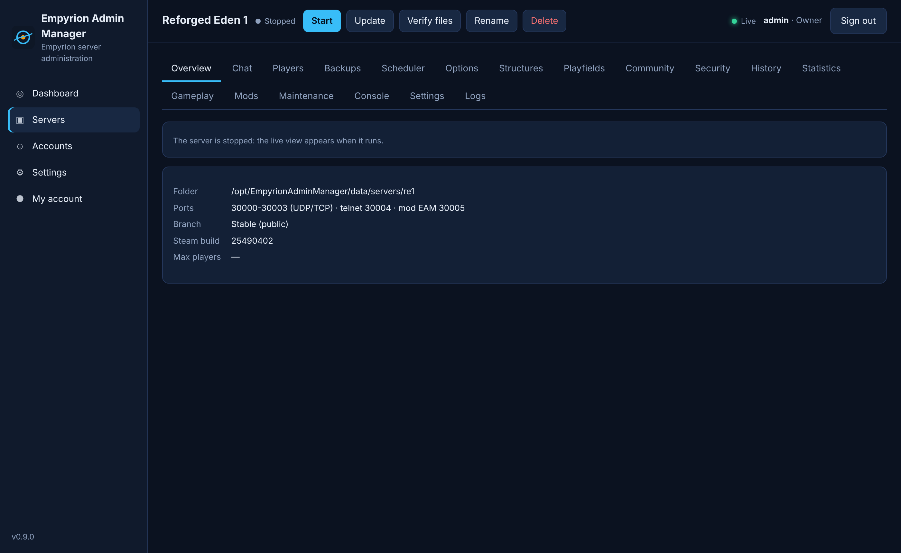

**8. Plan the routine.** In **Scheduler**, add a daily restart with a warning and a backup first, POI wipes, and log cleanup.

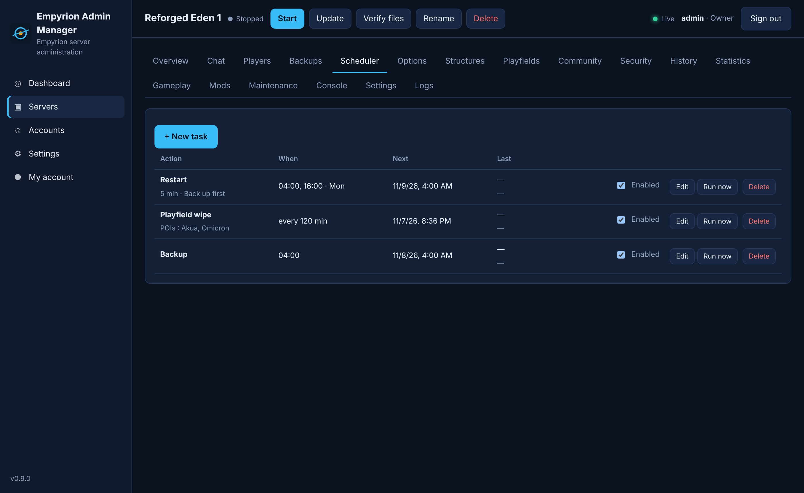

**9. Protect your players' work.** In **Backups**, set how many automatic backups to keep and an optional copy folder (Google Drive, OneDrive). Any backup can be downloaded or restored.

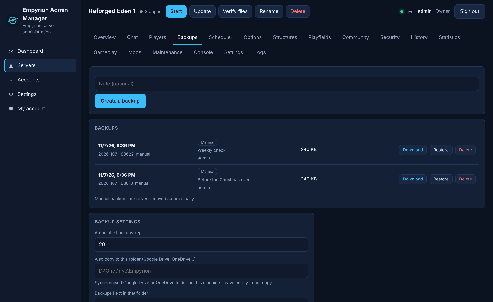

**10. Keep it running.** Double-click `Installer-le-service.cmd` (install the service) so the engine runs all the time, starts with Windows and restarts after a crash, even with the window closed.

## The desktop app and the web panel

EAM has one interface, shown in two ways:

- **Desktop app:** `EmpyrionAdminManager.exe` opens a Windows window with the full interface. Everything is available there.
- **Web panel:** the same interface in any browser, at `http://127.0.0.1:8790/` on the machine, or in HTTPS from anywhere once remote access is enabled. It works on a phone too.

Every feature lives in the shared interface, so both always offer exactly the same things.

| Live chat | Players |
| --- | --- |
| 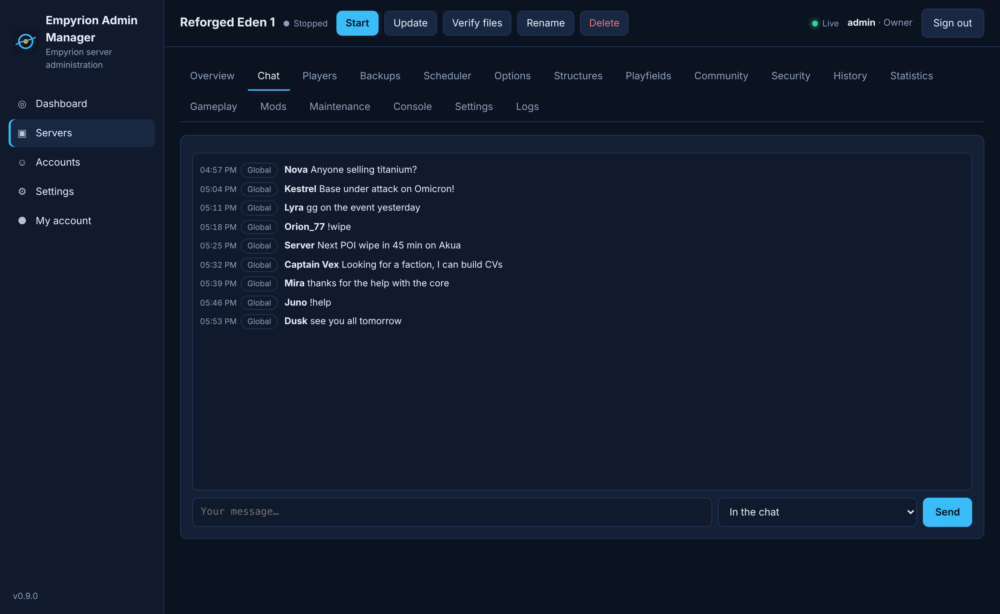 | 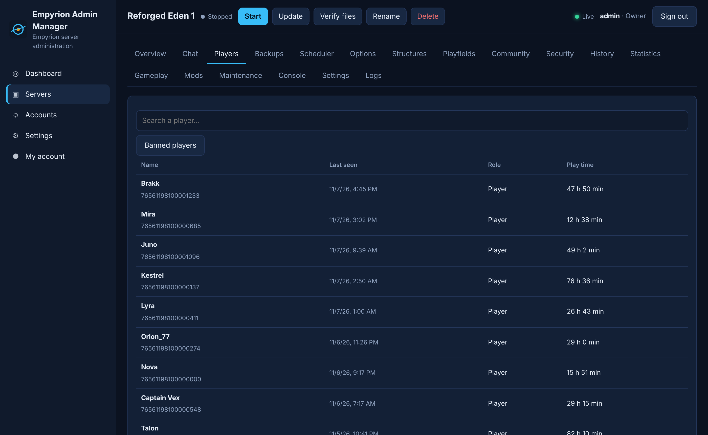 |

| Statistics (7 days) | Security journal and anti-cheat |
| --- | --- |
| 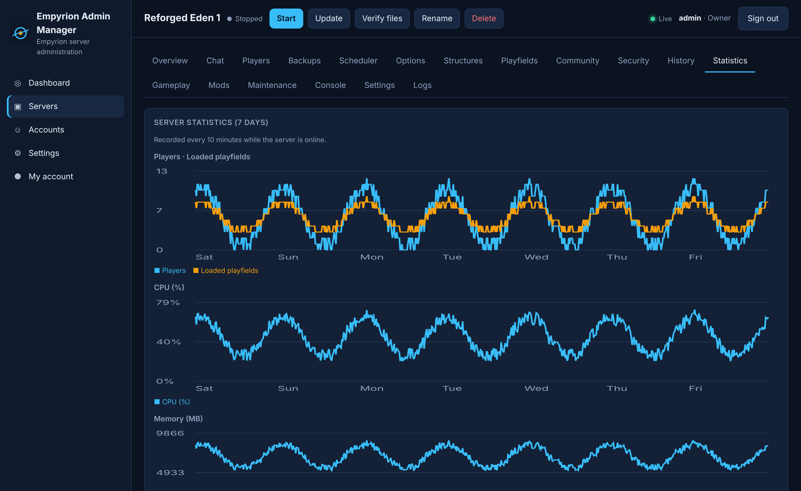 | 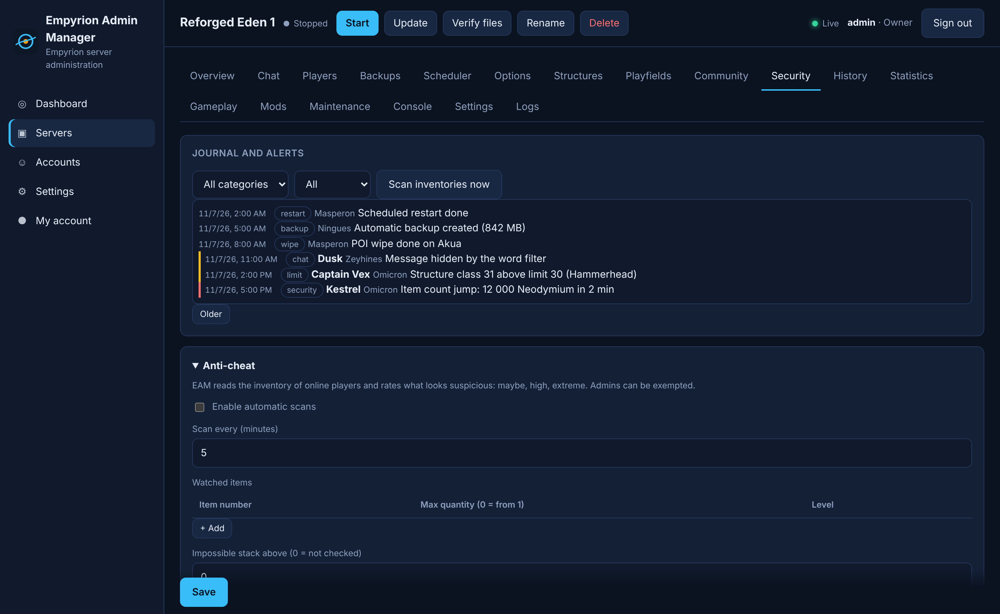 |

| Community and chatbot | Events and Autominer |
| --- | --- |
| 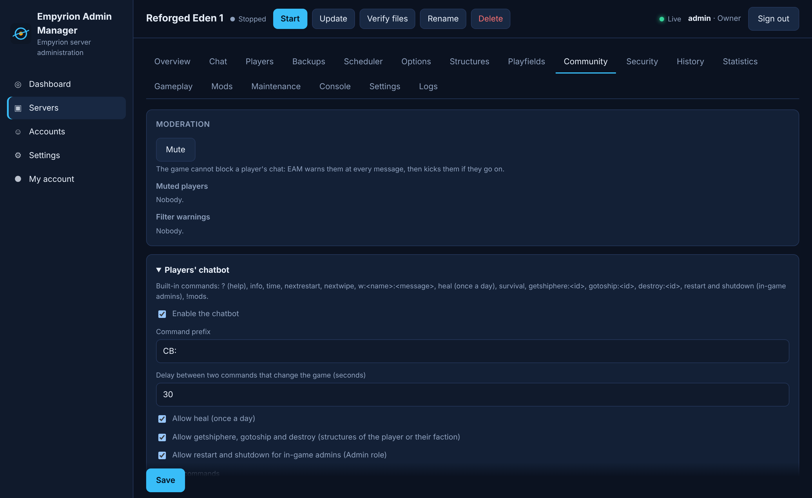 | 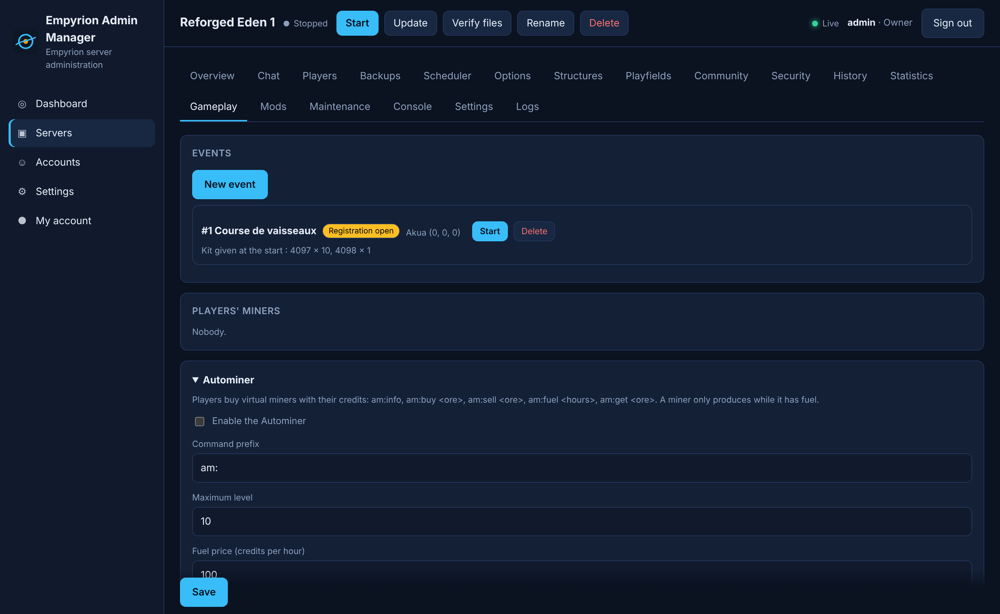 |

| Mods | Maintenance |
| --- | --- |
| 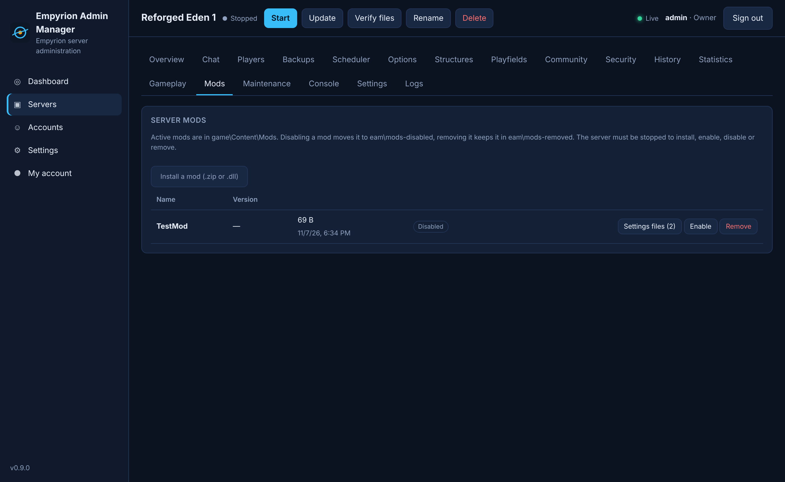 | 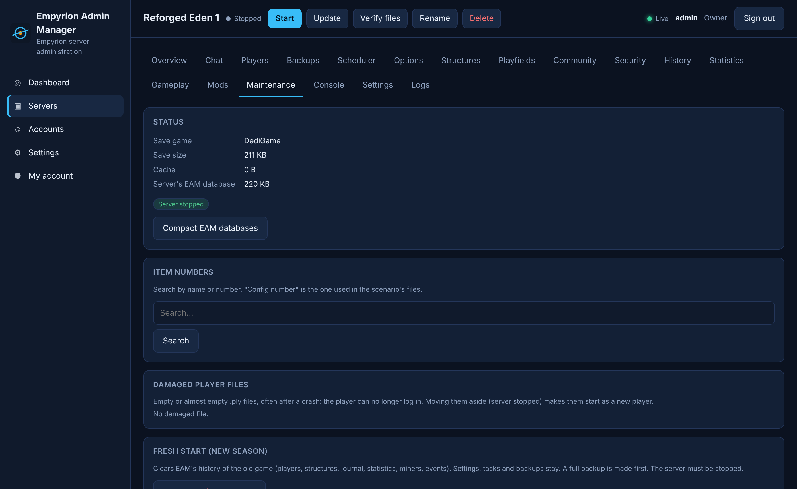 |

<p align="center">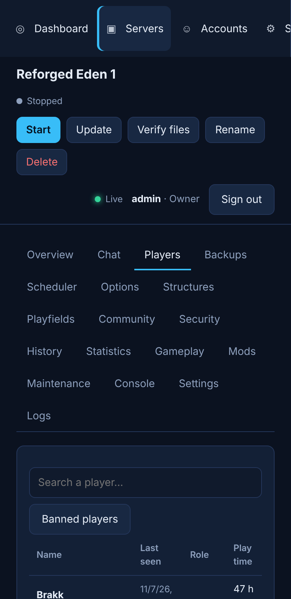</p>

## How it works

```
 Desktop window (WebView2) ─┐
                            ├──> EAM engine (Windows service) ──> SteamCMD, game files, backups
 Browser (HTTP / HTTPS) ────┘          │
                                       ├── server 1 ── EAM mod (127.0.0.1, own key)
                                       └── server 2 ── EAM mod (127.0.0.1, own key)
```

| Part | Folder | Role |
| --- | --- | --- |
| Engine | `src/Eam.Engine` | ASP.NET Core service (Windows service or portable). Serves the interface and the API, runs scheduled jobs. |
| Core | `src/Eam.Core` | Configuration, databases, accounts, monitoring. No UI. |
| Desktop | `src/Eam.Desktop` | Small window hosting the same interface with WebView2. Starts the engine if needed. |
| Game mod | `src/Eam.Mod` | Loaded by each dedicated server (.NET Framework 4.8). Talks to the engine on 127.0.0.1 only, with a key per server. Installed automatically at every start. |
| Link | `src/Eam.Link` | Protocol shared by the engine and the mod (challenge handshake, small JSON messages). |
| Interface | `src/Eam.Engine/wwwroot` | Plain HTML, CSS and JavaScript modules. No framework, no build step, strict CSP. |
| Tests | `tests/Eam.Tests` | xUnit tests. |

- The mod never opens a port to the Internet. The link uses port `game port + 5` on 127.0.0.1 only.
- Each server has its own SQLite database (chat, players, structures, journal, statistics).
- Settings EAM must write into game files are written only when the server is stopped.

## Accounts and roles

| Role | Can do |
| --- | --- |
| Owner | Everything, including accounts and EAM settings. |
| Administrator | Runs the servers: start, backups, configuration. |
| Game Master | Players, structures, chat, warps. |
| Moderator | Chat, kick, temporary bans. |
| Read only | Sees everything, changes nothing. |

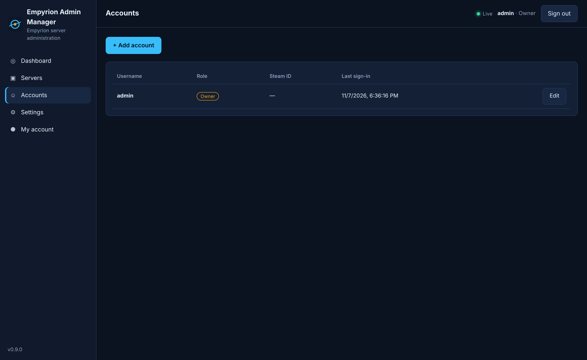

## Remote access and HTTPS

Remote access is off by default. In **Settings**:

1. Tick **Allow access from other machines** and choose the HTTPS port (8791 by default).
2. Use a self-signed certificate, your own `.pfx`, or tick **Let's Encrypt** for a free certificate renewed automatically. Let's Encrypt needs a domain name pointing to your public IP and port 80 forwarded to the EAM machine.
3. Open only that port in Windows Firewall and on your router.

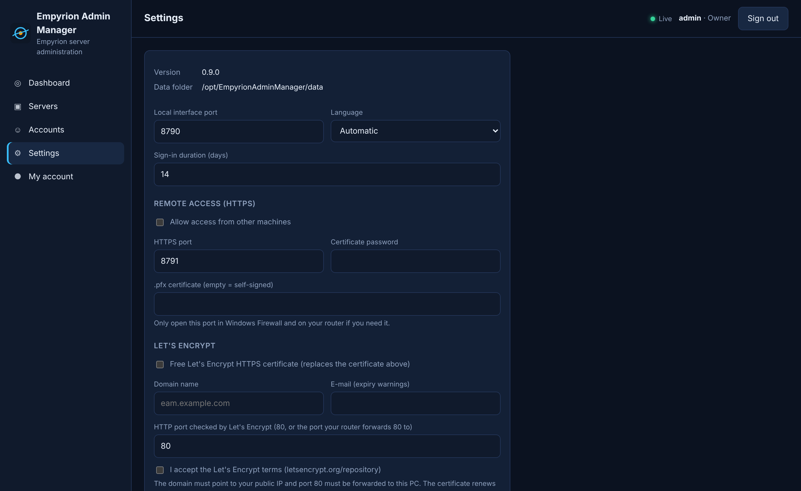

## Players' chatbot commands

The prefix is set in **Community** (default `CB:`). Examples with the default prefix:

| Command | What it does |
| --- | --- |
| `CB:help` | List of commands. |
| `CB:info` | Server information. |
| `CB:time` | Server time. |
| `CB:nextrestart`, `CB:nextwipe` | Next scheduled restart or wipe. |
| `CB:w:<name>:<message>` | Private message to a player. |
| `CB:heal` | Heal yourself (once a day). |
| `CB:survival` | Survival kit. |
| `CB:getshiphere:<id>`, `CB:gotoship:<id>` | Bring your ship to you, or go to it. |
| `CB:destroy:<id>` | Destroy one of your structures. |
| `CB:restart`, `CB:shutdown` | For in-game admins only. |
| `am:...` | Autominer commands (`am:info`, `am:buy`, `am:get`...). |

Each command can be turned on or off, and you can add your own commands.

## Where the data lives

- Installed mode: `C:\ProgramData\EmpyrionAdminManager`.
- Portable mode: the `data` folder next to the `.exe` files, when a `portable.txt` file is present.
- Or the folder given by the `EAM_DATA` environment variable.

Inside: `eam.json` (settings), `eam.db` (accounts), `logs\`, `keys\`, `certificates\`, `steamcmd\`, and one folder per server in `servers\<name>\` with `game\`, `eam\` (database and logs) and `backups\`.

## Updating EAM

1. Stop EAM (close the window, and stop the service if you installed it).
2. Unzip the new version over the old folder. Your `data` folder and `portable.txt` are kept.
3. Start EAM again. The mod in each server is updated at its next start.

## Troubleshooting

| Problem | What to check |
| --- | --- |
| The live view stays empty | Look in the game log (`game\Logs\<pid>\Dedicated_*.log`) for `Failed loading Mod dll`. The mod must be in `Content\Mods\EAM\EAM.dll`; EAM puts it there at every start. |
| A port is "in use" | Another program or server uses it. Choose another game port in the server settings. |
| The server restarts in a loop | After 3 crashes in 15 minutes EAM stops restarting it. Read the game log, then start it again. |
| Let's Encrypt fails | `http://your-domain/` must reach the EAM machine on port 80 from the Internet. |

## Building from source

```
dotnet test
pwsh tools/publish.ps1     # Windows (or tools/publish.sh on Linux with the Microsoft .NET 8 SDK)
```

The release lands in `dist/EmpyrionAdminManager-<version>.zip`.
Pushing a tag `vX.Y.Z` builds the release on GitHub and attaches the zip to it automatically.

`lib/empyrion/Mif.dll` is Eleon's modding interface from the game folder. It is used only to compile the EAM mod and is not shipped with EAM.

## Roadmap

- **Done (0.1 to 0.9):** foundations, servers and SteamCMD, mod and live view, backups and scheduler, options and scenarios, players, structures and world, community, security, Let's Encrypt, mods, Autominer, events, maintenance.
- **Next:** inventory history (give back a backpack after a bugged death), god mode, player saves and impersonation, partial restore of a structure or a player from a backup, more scheduler actions.
- **Then:** one-click import of a server that used EAH (all its data and settings), and version 1.0.

Ideas and bug reports are welcome in [Issues](../../issues).

## License

[MIT](LICENSE). Empyrion - Galactic Survival is a trademark of Eleon Game Studios. EAM is not affiliated with Eleon.

---

# Français

[English](#empyrion-admin-manager-eam) · **Français**

Outil d'administration libre et gratuit (MIT) pour les serveurs dédiés **Empyrion - Galactic Survival**.
Installez et gérez un ou plusieurs serveurs depuis une seule application de bureau Windows, ou à distance depuis n'importe quel navigateur :
SteamCMD, sauvegardes, planificateur, joueurs et chat en direct, structures, cartes, chatbot, Discord, anti-triche, journaux, statistiques, mods et événements.


> **État :** version 0.9.x, en cours de test. Elle peut être essayée sur un serveur de test.
> Gardez vos serveurs de production sur votre outil actuel jusqu'à la version 1.0.

## Sommaire

- [Pourquoi EAM](#pourquoi-eam)
- [Fonctions](#fonctions)
- [Configuration requise](#configuration-requise)
- [Démarrage rapide (tutoriel)](#démarrage-rapide-tutoriel)
- [L'application de bureau et le panel web](#lapplication-de-bureau-et-le-panel-web)
- [Comment ça marche](#comment-ça-marche)
- [Comptes et rôles](#comptes-et-rôles)
- [Accès à distance et HTTPS](#accès-à-distance-et-https)
- [Commandes du chatbot des joueurs](#commandes-du-chatbot-des-joueurs)
- [Où sont les données](#où-sont-les-données)
- [Mettre EAM à jour](#mettre-eam-à-jour)
- [Problèmes fréquents](#problèmes-fréquents)
- [Compiler le code](#compiler-le-code)
- [Feuille de route](#feuille-de-route)
- [Licence](#licence)

## Pourquoi EAM

- **Un seul programme pour tout.** Les fonctions d'un assistant d'administration et d'un accès web sont au même endroit, dans une fenêtre de bureau et dans un navigateur.
- **Plusieurs serveurs sur une machine.** Chaque serveur a son dossier, ses ports, sa base de données et ses sauvegardes. Les ports sont choisis et vérifiés automatiquement.
- **Rien à installer à la main.** SteamCMD est téléchargé au premier besoin. Empyrion, Reforged Eden 1 et Reforged Eden 2 s'installent depuis EAM.
- **Sûr par conception.** Une seule opération lourde à la fois par serveur, une sauvegarde avant toute action risquée, rien n'est effacé sans être d'abord mis de côté.
- **Écrit à neuf** et gratuit (licence MIT). Aucun code copié d'autres outils.

## Fonctions

### Serveurs
- SteamCMD intégré, téléchargé automatiquement dans le dossier d'EAM.
- Création d'un serveur avec le nom de son choix (nom EAM, dossier et nom dans la liste du jeu), renommable ensuite.
- Installation, mise à jour et vérification d'Empyrion depuis EAM, avec progression en direct (branche stable ou expérimentale).
- Plusieurs serveurs complètement séparés : un dossier chacun, ports attribués et vérifiés, un `dedicated-eam.yaml` propre à EAM que Steam n'écrase jamais.
- Démarrer, arrêter avec avertissement des joueurs et compte à rebours annulable, redémarrer, forcer l'arrêt.
- Détection des plantages, redémarrage automatique, suspendu après 3 plantages en 15 minutes.
- Console telnet, journal du jeu et journal EAM de chaque serveur.

### Vue en direct
- Joueurs en ligne (faction, playfield, niveau, ping, temps de connexion), playfields actifs (joueurs, FPS, mémoire, structures), FPS du serveur.
- Processeur et mémoire de chaque serveur (tous ses processus).
- Chat en direct avec 90 jours d'historique ; envoi d'un message dans le chat ou en fenêtre sur l'écran des joueurs.
- Notifications quand un joueur se connecte ou se déconnecte.

### Sauvegardes et planificateur
- Sauvegarde de la partie, des plans des joueurs, d'`adminconfig.yaml`, des options et des données EAM. Faite pendant que le serveur tourne.
- Télécharger, supprimer, restaurer (serveur arrêté, avec une sauvegarde de sécurité avant). Conservation des N dernières sauvegardes automatiques.
- Copie dans un dossier synchronisé (Google Drive, OneDrive...).
- Planificateur : redémarrage (avec avertissements et sauvegarde avant), arrêt, démarrage, sauvegarde, message, commande console, wipe de playfields, nettoyage des journaux, mise à jour du jeu. Heures fixes par jour de la semaine ou intervalle. Bouton « Lancer maintenant ».

### Options et scénarios
- Toutes les options de `dedicated.yaml` (actives ou en commentaire dans le modèle du jeu, avec leur aide) et édition du fichier complet.
- Nom de la sauvegarde, scénario, mode de jeu, graine.
- Toutes les options de jeu de la sauvegarde (`gameoptions.yaml`).
- Scénarios installés, installation et mise à jour de Reforged Eden 1 et 2 (ou de tout scénario) depuis le Steam Workshop, toujours la dernière version. Import depuis un dossier, suppression.

### Joueurs
- Tous les joueurs déjà vus, fiche détaillée, inventaire modifiable, crédits, expérience et points.
- Donner des objets (catalogue traduit du scénario), téléporter, soigner, terminer un plan.
- Message privé (remis à la prochaine connexion si le joueur est hors ligne), expulser, bannir et débannir, liste des bannis.
- Rôles dans `adminconfig.yaml`, historique complet des connexions et des actions des admins.

### Structures et monde
- Liste complète des structures (filtres par type, playfield, propriétaire, alimentation), fiche détaillée (blocs, appareils, objets), historique de chaque structure.
- Renommer, changer de propriétaire, déplacer (vers un playfield, une position ou un joueur), exporter, cloner, détruire (exportée d'abord), restaurer depuis la bibliothèque d'EAM.
- Plans (.epb) : import, liste, apparition en jeu. Nettoyage du dossier `Shared` (les dossiers des structures disparues sont mis de côté, jamais effacés).
- Limites par joueur ou faction (nombre, classe, blocs, par playfield) : avertissement puis suppression après un délai.
- Wipes automatiques (structures non visitées, playfields de départ), playfields réservés à certains joueurs ou factions.
- Playfields : liste, chargement, wipe. Carte 2D/3D des structures et des joueurs. Carte de la galaxie.

### Communauté
- Chatbot des joueurs avec le préfixe de votre choix (voir les [commandes](#commandes-du-chatbot-des-joueurs)), plus des commandes personnalisées.
- Alertes (mots surveillés, événements graves) avec son et notification.
- Traduction du chat, filtre d'insultes (avertissements puis bannissements progressifs), joueurs muets.
- Message du jour, message de bienvenue, message à l'entrée d'un playfield.
- Pont Discord : chat global dans les deux sens, salons de faction, salon des admins pour les alertes.

### Sécurité
- Anti-triche : objets interdits, piles trop grandes, vie et nourriture, crédits qui sautent. Bannissement automatique possible.
- Journal des attaques de bases, historique « que s'est-il passé ici » (positions des joueurs et des structures sur 14 jours), suivi d'un joueur.
- Contrôle des pôles, téléportation d'urgence à la déconnexion, protection contre le flood telnet.
- Statistiques sur 7 jours : joueurs, FPS, mémoire, playfields, morts, cœurs posés et retirés, avec conseils.

### Extras de jeu
- Autominer : mineurs virtuels achetés avec des crédits, carburant, stock limité, 13 minerais par défaut.
- Événements : inscription des joueurs, départ avec kit et téléportation, inventaire mis de côté puis rendu, retour à la position d'origine (même si le joueur était déconnecté).
- Gestionnaire de mods : installation (.zip ou .dll), activer, désactiver, supprimer (gardé de côté), édition des fichiers de réglages avec copie de l'ancien.

### Maintenance et plateforme
- Compactage des bases, « nouveau départ » pour une nouvelle saison (sauvegarde avant), fichiers joueurs abîmés, convertisseur de numéros d'objets.
- Certificat HTTPS gratuit Let's Encrypt, renouvelé tout seul.
- Comptes avec 5 rôles, mots de passe chiffrés (PBKDF2), blocage après 5 échecs de connexion.
- Interface en français et en anglais.

## Configuration requise

- Windows 10/11 ou Windows Server 2019 ou plus récent, 64 bits.
- Microsoft Edge WebView2 pour la fenêtre de bureau (déjà présent sur la plupart des Windows).
- De la place disque pour le jeu et son scénario sur chaque serveur, plus les sauvegardes.
- Rien d'autre : EAM est autonome (pas de .NET à installer).

## Démarrage rapide (tutoriel)

**1. Télécharger.** Prenez `EmpyrionAdminManager-X.Y.Z.zip` sur la page [Releases](../../releases) et décompressez-le où vous voulez, par exemple `C:\EmpyrionAdminManager`.

**2. Lancer EAM.** Lancez `EmpyrionAdminManager.exe`. La fenêtre démarre le moteur et vous demande de créer le premier compte administrateur. Ce premier compte ne peut être créé que sur la machine d'EAM.


**3. Tableau de bord.** Vous voyez le processeur, la mémoire et les disques de la machine, et la liste de vos serveurs.


**4. Créer un serveur.** Ouvrez **Serveurs**, cliquez sur **Nouveau serveur**, choisissez un nom, la branche (stable ou expérimentale) et les options. Les ports sont choisis pour vous.


**5. Installer le jeu.** Sur la page du serveur, cliquez sur **Installer**. EAM télécharge SteamCMD la première fois, puis Empyrion. La progression s'affiche en direct.

**6. Choisir le scénario.** Dans **Options**, installez Reforged Eden 1 ou 2 depuis le Steam Workshop (ou gardez le scénario par défaut), choisissez le nom de la sauvegarde, le mode et la graine, et réglez n'importe quelle option du jeu.


**7. Démarrer le serveur.** Cliquez sur **Démarrer**. EAM installe son petit mod dans le serveur, puis la vue en direct affiche les joueurs, les playfields et le chat.


**8. Planifier la routine.** Dans **Planificateur**, ajoutez un redémarrage quotidien avec avertissement et sauvegarde avant, des wipes de POI et le nettoyage des journaux.


**9. Protéger le travail des joueurs.** Dans **Sauvegardes**, choisissez combien de sauvegardes automatiques garder et un dossier de copie (Google Drive, OneDrive). Chaque sauvegarde peut être téléchargée ou restaurée.


**10. Le laisser tourner.** Double-cliquez sur `Installer-le-service.cmd` : le moteur tourne en permanence, démarre avec Windows et redémarre après un plantage, même fenêtre fermée.

## L'application de bureau et le panel web

EAM a une seule interface, affichée de deux façons :

- **Application de bureau :** `EmpyrionAdminManager.exe` ouvre une fenêtre Windows avec toute l'interface. Tout y est disponible.
- **Panel web :** la même interface dans n'importe quel navigateur, sur `http://127.0.0.1:8790/` sur la machine, ou en HTTPS de partout une fois l'accès à distance activé. Il marche aussi sur téléphone.

Chaque fonction vit dans l'interface commune : les deux offrent toujours exactement la même chose.

| Chat en direct | Joueurs |
| --- | --- |
|  |  |

| Statistiques (7 jours) | Journal de sécurité et anti-triche |
| --- | --- |
|  |  |

| Communauté et chatbot | Événements et Autominer |
| --- | --- |
|  |  |

| Mods | Maintenance |
| --- | --- |
|  |  |

<p align="center"></p>

## Comment ça marche

```
 Fenêtre de bureau (WebView2) ─┐
                               ├──> moteur EAM (service Windows) ──> SteamCMD, fichiers du jeu, sauvegardes
 Navigateur (HTTP / HTTPS) ────┘          │
                                          ├── serveur 1 ── mod EAM (127.0.0.1, sa propre clé)
                                          └── serveur 2 ── mod EAM (127.0.0.1, sa propre clé)
```

| Partie | Dossier | Rôle |
| --- | --- | --- |
| Moteur | `src/Eam.Engine` | Service ASP.NET Core (service Windows ou portable). Sert l'interface et l'API, lance les tâches planifiées. |
| Cœur | `src/Eam.Core` | Configuration, bases de données, comptes, surveillance. Sans interface. |
| Bureau | `src/Eam.Desktop` | Petite fenêtre qui affiche la même interface avec WebView2. Démarre le moteur si besoin. |
| Mod du jeu | `src/Eam.Mod` | Chargé par chaque serveur dédié (.NET Framework 4.8). Parle au moteur sur 127.0.0.1 seulement, avec une clé par serveur. Installé automatiquement à chaque démarrage. |
| Lien | `src/Eam.Link` | Protocole commun au moteur et au mod (poignée de main par défi, petits messages JSON). |
| Interface | `src/Eam.Engine/wwwroot` | HTML, CSS et modules JavaScript simples. Sans framework, sans compilation, CSP stricte. |
| Tests | `tests/Eam.Tests` | Tests xUnit. |

- Le mod n'ouvre jamais de port sur Internet. Le lien utilise le port `port du jeu + 5` sur 127.0.0.1 uniquement.
- Chaque serveur a sa propre base SQLite (chat, joueurs, structures, journal, statistiques).
- Les réglages qu'EAM doit écrire dans les fichiers du jeu ne sont écrits que serveur arrêté.

## Comptes et rôles

| Rôle | Peut faire |
| --- | --- |
| Propriétaire | Tout, y compris les comptes et les paramètres d'EAM. |
| Administrateur | Gère les serveurs : démarrage, sauvegardes, configuration. |
| Game Master | Joueurs, structures, chat, téléportations. |
| Modérateur | Chat, kick, bannissements temporaires. |
| Lecture seule | Voit tout, ne modifie rien. |


## Accès à distance et HTTPS

L'accès à distance est désactivé par défaut. Dans **Paramètres** :

1. Cochez **Autoriser l'accès depuis d'autres machines** et choisissez le port HTTPS (8791 par défaut).
2. Utilisez un certificat auto-signé, votre propre `.pfx`, ou cochez **Let's Encrypt** pour un certificat gratuit renouvelé tout seul. Let's Encrypt demande un nom de domaine qui pointe vers votre IP publique et le port 80 redirigé vers la machine d'EAM.
3. N'ouvrez que ce port dans le pare-feu Windows et sur votre box.


## Commandes du chatbot des joueurs

Le préfixe se règle dans **Communauté** (par défaut `CB:`). Exemples avec le préfixe par défaut :

| Commande | Effet |
| --- | --- |
| `CB:help` | Liste des commandes. |
| `CB:info` | Informations sur le serveur. |
| `CB:time` | Heure du serveur. |
| `CB:nextrestart`, `CB:nextwipe` | Prochain redémarrage ou wipe planifié. |
| `CB:w:<nom>:<message>` | Message privé à un joueur. |
| `CB:heal` | Se soigner (une fois par jour). |
| `CB:survival` | Kit de survie. |
| `CB:getshiphere:<id>`, `CB:gotoship:<id>` | Faire venir son vaisseau, ou aller à lui. |
| `CB:destroy:<id>` | Détruire une de ses structures. |
| `CB:restart`, `CB:shutdown` | Réservées aux admins en jeu. |
| `am:...` | Commandes de l'Autominer (`am:info`, `am:buy`, `am:get`...). |

Chaque commande peut être activée ou non, et vous pouvez ajouter vos propres commandes.

## Où sont les données

- Mode installé : `C:\ProgramData\EmpyrionAdminManager`.
- Mode portable : le dossier `data` à côté des `.exe`, quand un fichier `portable.txt` est présent.
- Ou le dossier donné par la variable d'environnement `EAM_DATA`.

Dedans : `eam.json` (paramètres), `eam.db` (comptes), `logs\`, `keys\`, `certificates\`, `steamcmd\`, et un dossier par serveur dans `servers\<nom>\` avec `game\`, `eam\` (base et journaux) et `backups\`.

## Mettre EAM à jour

1. Arrêtez EAM (fermez la fenêtre, et arrêtez le service s'il est installé).
2. Décompressez la nouvelle version par-dessus l'ancien dossier. Votre dossier `data` et `portable.txt` sont conservés.
3. Relancez EAM. Le mod de chaque serveur est mis à jour à son prochain démarrage.

## Problèmes fréquents

| Problème | À vérifier |
| --- | --- |
| La vue en direct reste vide | Cherchez `Failed loading Mod dll` dans le journal du jeu (`game\Logs\<pid>\Dedicated_*.log`). Le mod doit être dans `Content\Mods\EAM\EAM.dll` ; EAM l'y place à chaque démarrage. |
| Un port est « utilisé » | Un autre programme ou serveur l'utilise. Choisissez un autre port de jeu dans les réglages du serveur. |
| Le serveur redémarre en boucle | Après 3 plantages en 15 minutes, EAM arrête de le relancer. Lisez le journal du jeu, puis redémarrez-le. |
| Let's Encrypt échoue | `http://votre-domaine/` doit atteindre la machine d'EAM sur le port 80 depuis Internet. |

## Compiler le code

```
dotnet test
pwsh tools/publish.ps1     # Windows (ou tools/publish.sh sous Linux avec le SDK .NET 8 de Microsoft)
```

La version se trouve dans `dist/EmpyrionAdminManager-<version>.zip`.
Pousser un tag `vX.Y.Z` compile la version sur GitHub et y joint le zip automatiquement.

`lib/empyrion/Mif.dll` est l'interface de modding d'Eleon, issue du dossier du jeu. Il sert seulement à compiler le mod EAM et n'est pas livré avec EAM.

## Feuille de route

- **Fait (0.1 à 0.9) :** fondations, serveurs et SteamCMD, mod et vue en direct, sauvegardes et planificateur, options et scénarios, joueurs, structures et monde, communauté, sécurité, Let's Encrypt, mods, Autominer, événements, maintenance.
- **Ensuite :** historique des inventaires (rendre un sac à dos après une mort buggée), mode dieu, sauvegardes de joueurs et incarnation, restauration partielle d'une structure ou d'un joueur depuis une sauvegarde, nouvelles actions du planificateur.
- **Puis :** import en un clic d'un serveur qui utilisait EAH (toutes ses données et réglages), et la version 1.0.

Idées et rapports de bugs bienvenus dans les [Issues](../../issues).

## Licence

[MIT](LICENSE). Empyrion - Galactic Survival est une marque d'Eleon Game Studios. EAM n'est pas affilié à Eleon.
